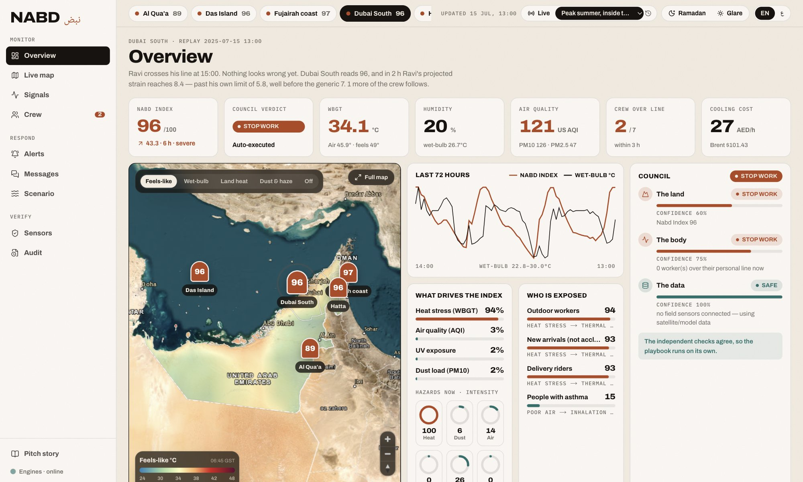
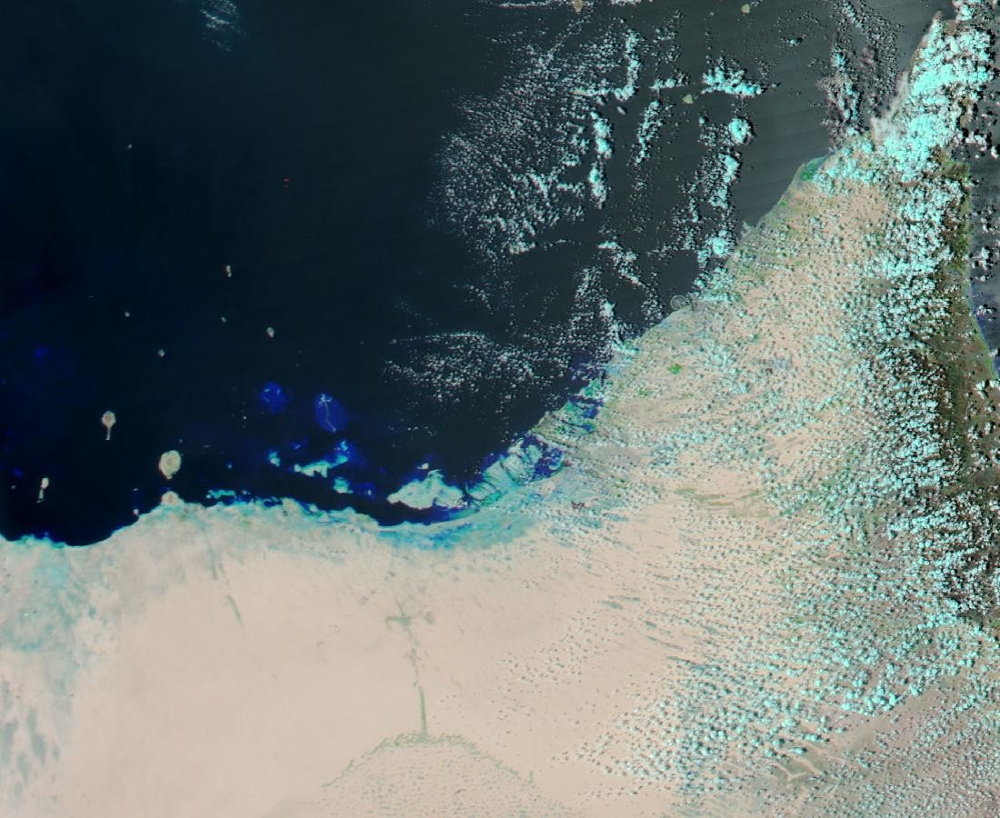
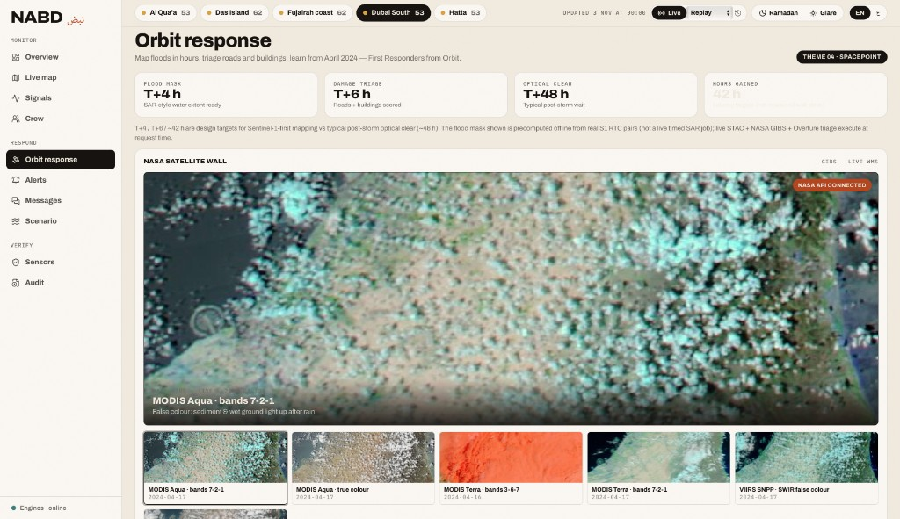
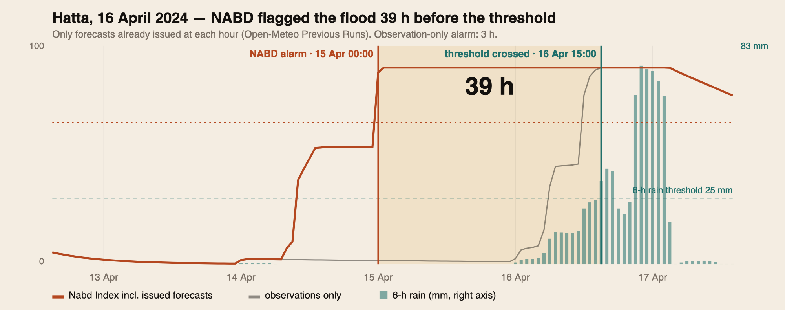
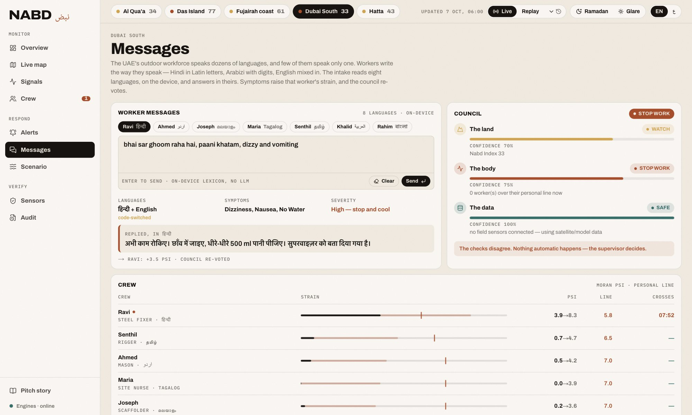
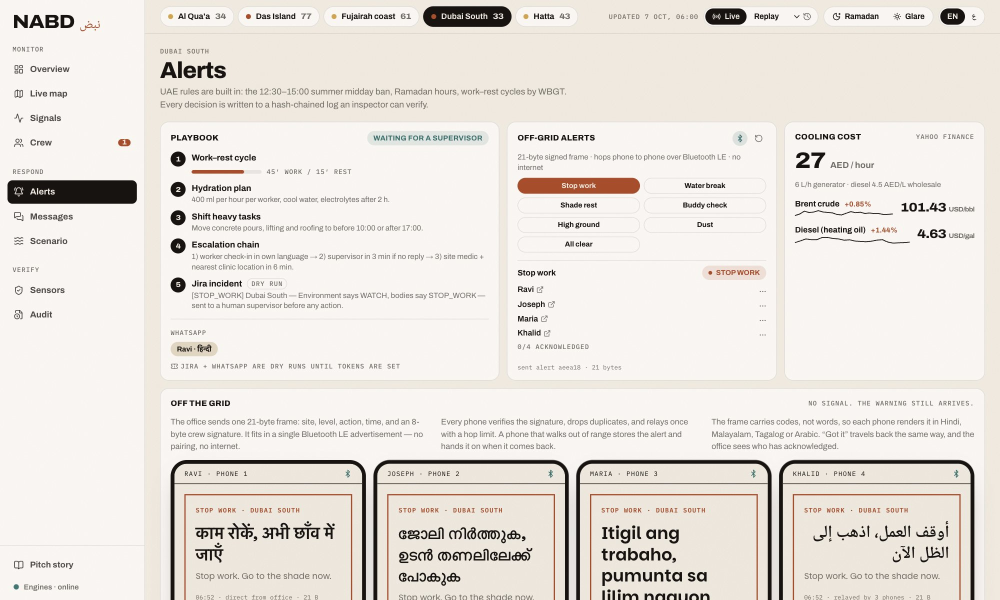
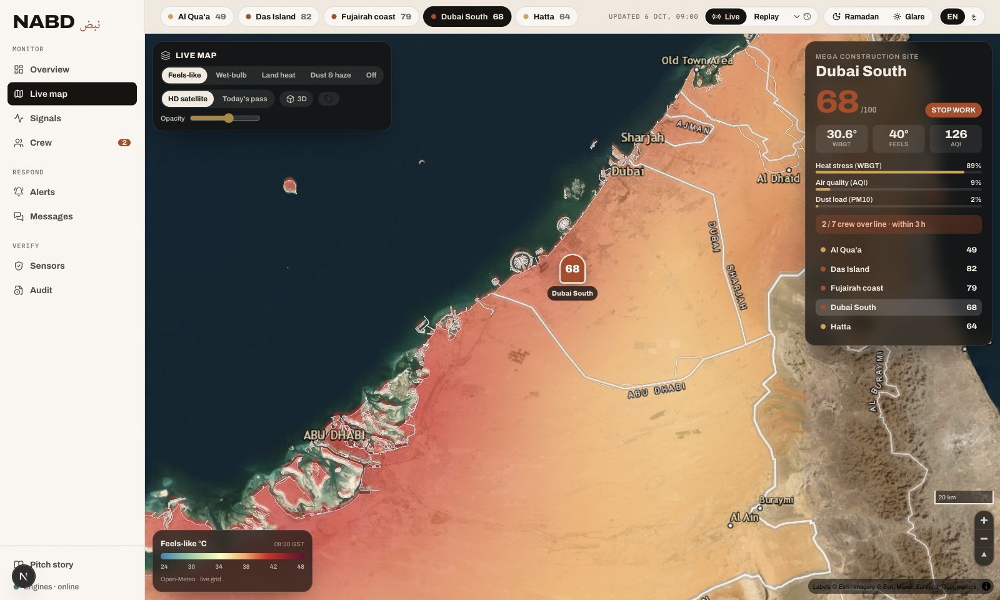
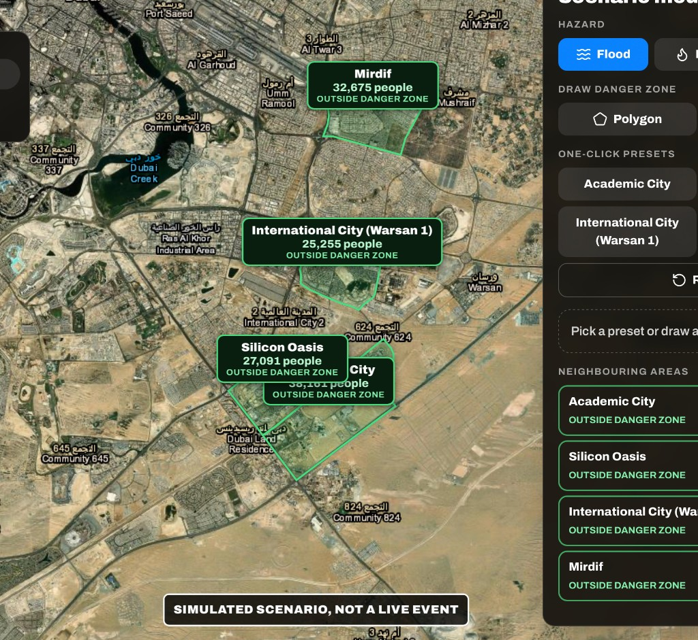
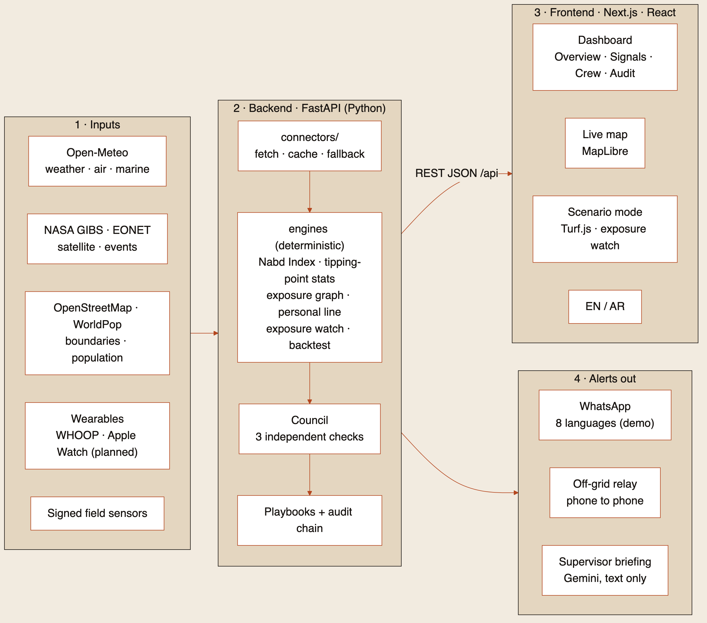

# NABD Orbit نبض

**Supernova × SpacePoint · Theme 04 — First Responders from Orbit**

**Live demo:** [https://qwen-supernova-2.onrender.com](https://qwen-supernova-2.onrender.com) · cold-start ~30–60s on free Render.  
**Demo video:** [Google Drive](https://drive.google.com/drive/folders/10RjlP-vZgU97e-VpDHzhiybuU0HiYyhU?usp=sharing)

**Pitch:** NABD (نبض, *pulse*) turns a satellite overpass into a first-responder flood + damage view, then gets the decision to outdoor workers in their language — even when the site has no internet.  
**Score Theme 04 on [`/orbit`](https://qwen-supernova-2.onrender.com/orbit) + EO APIs;** the safety stack is the reused last mile ([built vs reused](#built-for-this-hackathon-vs-reused-platform)).

**Who:** emergency / site coordinators and the multilingual outdoor workforce they protect.  
**Problem:** after the **April 2024 UAE floods**, warnings existed, but responders still needed *where the water was* and *which roads and buildings were cut* within hours — not after optical clear (~2 days) — and crews still needed alerts they could read offline.

| Pillar | Open | What to click (2 min) |
|---|---|---|
| **Satellite** | [/orbit](https://qwen-supernova-2.onrender.com/orbit) | NASA wall · scrub **T+0 → T+6 → T+12** (hours after onset) · Overture triage |
| **Multilingual** | [/messages](https://qwen-supernova-2.onrender.com/messages) | Type mixed-language symptoms (**codeswitch** = one message mixing languages; on-device, no LLM) · watch the **council** (rule engine: land × body × data integrity → SAFE / WATCH / STOP_WORK; never auto-clears untrusted data) |
| **Offline** | [/alerts](https://qwen-supernova-2.onrender.com/alerts) | Fire a **21-byte** signed frame (fits a BLE advert → phones with no internet). Demo radio = **BroadcastChannel**, not real BLE |

<p align="center"></p>

---

## Built for this hackathon vs reused platform

| Built / extended for Theme 04 (this weekend’s EO path) | Reused from the earlier NABD safety platform |
|---|---|
| `/orbit` UI + `/api/orbit/*` — NASA GIBS wall, STAC scenes, S1 flood GeoJSON + provenance, Overture triage, rainfall, phase timeline | Live weather fusion `/api/sites/*`, hazard bands, **council**, **exposure graph**, crew strain |
| S1 RTC precompute script + stored scene-ID tests | Multilingual **codeswitch** intake, EN/AR + RTL UI |
| Render Docker deploy for the combined app | **21-byte** signed alert frame + mesh demo; Mirage trust / audit hash chain |

---

## Theme 04 — what we ship for the ask

| Theme ask | What NABD ships |
|---|---|
| **Map floods in hours** | Precomputed **Sentinel-1 RTC** before/after change mask (VV **−3 dB** change · **−15 dB** dark). Scene IDs stored + pytest-checked. Live **STAC** lists the S1/S2/DEM catalogue. Timeline scrubber uses **T+N** = hours after onset (e.g. **T+6** = six hours into the event). |
| **Damage to roads & buildings** | Flood GeoJSON scored against roads/buildings + **3,000+** real Overture hospitals/schools/clinics. |
| **Learn from April 2024** | Event briefing, archive rainfall, NASA GIBS week gallery, Hatta early-warning backtest (**39 h** lead on archived forecasts). |
| **Theme data** | Sentinel-1 · Sentinel-2 · Copernicus DEM (Element84 STAC) + NASA GIBS WMS (keyless). |

**Honest limits**

- Flood mask is **unvalidated** — offline-precomputed from real S1 RTC pairs (not a live timed SAR job); km² includes morphological smoothing.
- **T+4 / T+6** vs ~**T+48** optical are **design targets**, not wall-clock of this repo.
- Offline demo radio is browser **BroadcastChannel** with simulated range — **not** real Bluetooth LE.

---

## Judge path — smoke APIs

```bash
curl -s https://qwen-supernova-2.onrender.com/api/health
curl -s https://qwen-supernova-2.onrender.com/api/orbit/nasa | head -c 180
curl -s https://qwen-supernova-2.onrender.com/api/orbit/scenes | head -c 180
curl -s "https://qwen-supernova-2.onrender.com/api/orbit/facilities?phase_id=t6" | head -c 180
```

---

## Evidence — from orbit

| NASA / EO | Prototype (live Render) |
|:---:|:---:|
|  |  |
| False-colour GIBS (live WMS) | `/orbit` — NASA wall + KPIs |

Also: live STAC → `GET /api/orbit/scenes`. Mask provenance → scene IDs in GeoJSON + `pytest` (`test_flood_mask_comes_from_stored_scene_ids`).

<p align="center"></p>
<sub>Hatta backtest: archived forecasts only — **39 h** lead before the flood threshold (observations alone ≈ 3 h). Engine is tested for **no look-ahead**.</sub>

---

## Evidence — multilingual + offline last mile

Flood maps alone don’t reach a worker who doesn’t speak English and whose site lost connectivity. NABD carries the decision the last mile.

| Multilingual | Offline last mile |
|:---:|:---:|
|  |  |
| [/messages](https://qwen-supernova-2.onrender.com/messages) · **8 languages** · codeswitch · no LLM | [/alerts](https://qwen-supernova-2.onrender.com/alerts) · **21 bytes** ≈ BLE advert payload · demo = BroadcastChannel |

**Why 21 bytes:** a Bluetooth LE advertisement is tiny. Packing site, level, action, and time into **21 signed bytes** means the *same* frame can hop phone-to-phone without pairing or internet. This repo demos the frame + relay logic in-browser; it does **not** claim a field BLE test.

---

## Reused platform (last mile around the orbit decision)

Not Theme 04 scoring criteria — shows the same product can take a hazard into exposure + site action.

| Live heat map · STOP WORK | Scenario · flood exercise (simulated) |
|:---:|:---:|
|  |  |
| [/map](https://qwen-supernova-2.onrender.com/map) · Open-Meteo layers · council level | [/scenario](https://qwen-supernova-2.onrender.com/scenario) · draw zone · population in/out · **not a live event** |

---

## Architecture

```
Browser (Next.js)
    │  /api/*
    ▼
FastAPI (nabd)
    ├── /api/orbit/*     Theme 04 — GIBS, STAC, S1 mask GeoJSON, Overture triage
    ├── /api/sites/*     Weather fusion → hazards → exposure graph → council
    ├── intake / alerts  Codeswitch + 21-byte signed frames (BroadcastChannel demo)
    └── audit            Hash-chained decision log
```

| Term | Meaning |
|---|---|
| **Council** | Deterministic rule engine: land × body × data integrity → SAFE / WATCH / STOP_WORK; never auto-clears untrusted data. |
| **Exposure graph** | Who is downstream of which hazard (cohorts / pathways / outcomes). |
| **Mirage red-team** | Automated attacks on sensor packets (forgery, replay, clone swarm) to prove the trust layer rejects them. |
| **Codeswitch** | One utterance mixing languages (e.g. Hindi + English); lexicon match on-device, no LLM. |
| **T+N** | Hours after flood onset on the scrubber (T+0 first heavy band → T+6 damage triage target). |

| Layer | Implementation |
|---|---|
| **EO catalogue** | Element84 Earth Search STAC — Sentinel-1 GRD, Sentinel-2, Copernicus GLO-30 DEM |
| **NASA context** | GIBS WMS GetMap (reflectance gallery for 14–17 Apr 2024) |
| **Flood mask** | Offline S1 RTC VV change detection → `backend/nabd/data/s1_flood_mask_apr2024.geojson` + provenance JSON |
| **Critical places** | Overture Maps places extract (hospitals / schools / clinics) |
| **Weather** | Open-Meteo; disk/memory cache; synthetic fallback on HTTP 429 |
| **Trust** | Signed packets, Mirage red-team, council never auto-clears untrusted data |

**Stack:** FastAPI + Next.js · one Docker image on Render · pytest on the critical engines.

<p align="center"></p>

---

## Local run (~5 minutes)

**Needs:** Python 3.11+, Node 20+.

```bash
git clone https://github.com/Shreeya1-pixel/Qwen_Supernova.git
cd Qwen_Supernova

# Terminal 1 — API
cd backend
python3 -m venv .venv && source .venv/bin/activate
pip install -r requirements.txt
uvicorn nabd.main:app --host 127.0.0.1 --port 8040

# Terminal 2 — UI
cd frontend && npm install && npm run dev
```

| URL | Role |
|---|---|
| http://127.0.0.1:3848/orbit | Theme 04 primary page |
| http://127.0.0.1:8040/api/health | API health |
| http://127.0.0.1:3848/alerts | Off-grid relay demo |
| http://127.0.0.1:3848/messages | Multilingual intake |

```bash
cd backend && source .venv/bin/activate && pytest -q
```

---

## Tests (technically checkable)

**20 tests pass locally**, including:

| Area | Coverage |
|---|---|
| **Orbit / Theme 04** | Phases expand · triage KPIs · briefing · **flood mask ↔ stored S1 scene IDs** |
| **Early warning** | Critical slowing-down · stable ≠ tipping · daily cycle rejected |
| **Backtest** | **No look-ahead** into the future |
| **Exposure** | Heat → new arrivals · sea warming → water path · WBGT sanity |
| **Trust** | Accepts honest packets · rejects forgery / replay / clone swarm |
| **Council** | Never auto-clears untrusted data · divergence → human |
| **Multilingual** | Codeswitch intake · bilingual sun alert states the limit |

---

## Theme 04 APIs

| Endpoint | Role |
|---|---|
| `GET /api/orbit` | Briefing + KPIs |
| `GET /api/orbit/nasa` | NASA GIBS gallery |
| `GET /api/orbit/scenes` | Sentinel-1 · Sentinel-2 · Copernicus DEM |
| `GET /api/orbit/facilities?phase_id=t6` | Overture places vs flood mask |
| `GET /api/orbit/phases/{t0\|t4\|t6\|t12\|t24}` | Flood + damage GeoJSON |
| `GET /api/orbit/rainfall` | April 2024 precip near Hatta |

---

## Deploy

**Live:** [https://qwen-supernova-2.onrender.com](https://qwen-supernova-2.onrender.com)

Default blueprint = **one Docker service** ([`render.yaml`](render.yaml) + [`Dockerfile`](Dockerfile)). Guide: [DEPLOY_RENDER.md](DEPLOY_RENDER.md). Split services (optional): [`deploy/render.split.yaml`](deploy/render.split.yaml).

---

## Repo layout

```
backend/     FastAPI (nabd/) · tests · S1 mask data · precompute script
frontend/    Next.js UI
docs/        Architecture, methods, imagery
deploy/      Extra Render blueprints
Dockerfile   Production image (UI static export + API)
render.yaml  Default Render blueprint (Docker)
```

---

<sub>NASA GIBS · Copernicus / Element84 STAC · Overture Maps · Open-Meteo · © OpenStreetMap. Supernova × SpacePoint · BITS Pilani Dubai.</sub>
