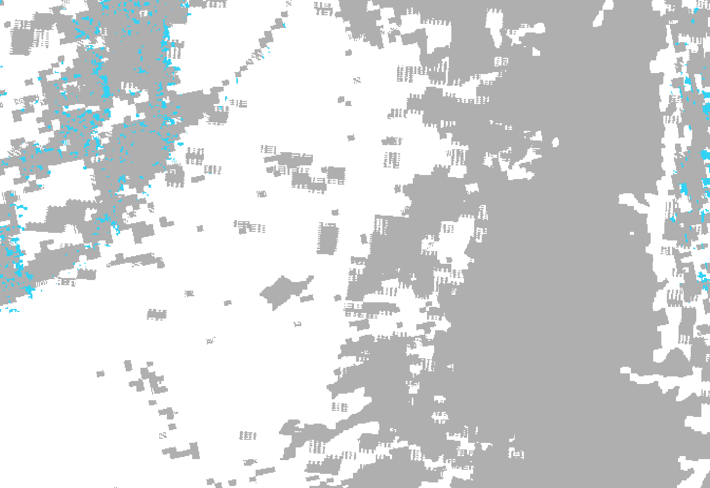
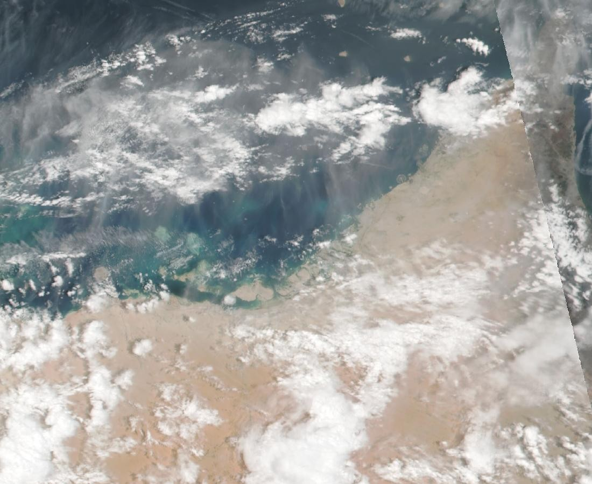
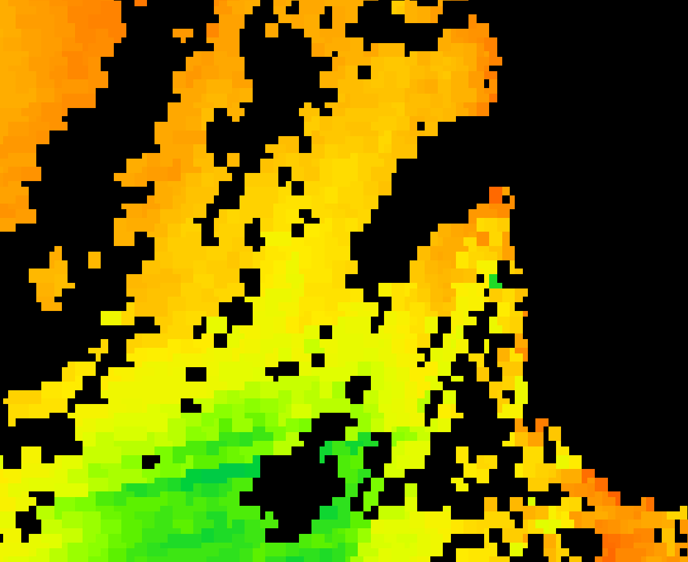

# NABD Orbit نبض

## Supernova × SpacePoint Hackathon

Right now, a satellite is crossing the UAE. It sees clouds over the Hajar, ships in Hormuz, cities spreading into the sand. **Most of it goes unused.**

You get **real satellite data** and one week to build something that matters — then the top 8 teams pitch live to the judges.

**We built NABD Orbit** so that pass is not wasted when the next flood hits.

> Map floods within hours, not days · Assess damage to roads and buildings · Learn from the **April 2024 UAE floods**  
> **Data:** Sentinel-1 radar · Sentinel-2 · Copernicus DEM · **NASA GIBS** (live)

**Repo:** [Shreeya1-pixel/Qwen_Supernova](https://github.com/Shreeya1-pixel/Qwen_Supernova)

<p align="center"></p>

---

## For judges — run in ~5 minutes

**Needs:** Python 3.11+, Node 20+, two terminals.

```bash
git clone https://github.com/Shreeya1-pixel/Qwen_Supernova.git
cd Qwen_Supernova

# Terminal 1 — API
cd backend
python3 -m venv .venv && source .venv/bin/activate   # Windows: .venv\Scripts\activate
pip install -r requirements.txt
uvicorn nabd.main:app --host 127.0.0.1 --port 8040

# Terminal 2 — UI
cd frontend
npm install
npm run dev
```

| Open this | Why |
|---|---|
| **http://127.0.0.1:3848/orbit** | **Primary Theme 04 page** — NASA wall, flood timeline, Overture triage |
| http://127.0.0.1:8040/api/health | API alive |
| http://127.0.0.1:8040/api/orbit/nasa | Live NASA GIBS JSON |
| http://127.0.0.1:3848/messages | Multilingual intake |
| http://127.0.0.1:3848/alerts | Off-grid / offline relay |

**Smoke checks**

```bash
curl -s http://127.0.0.1:8040/api/health
curl -s http://127.0.0.1:8040/api/orbit/scenes | head -c 200
curl -s "http://127.0.0.1:8040/api/orbit/facilities?phase_id=t6" | head -c 200
cd backend && source .venv/bin/activate && pytest -q
```

---

## The problem (compact)

In **April 2024** the UAE saw record rain (**254.8 mm** in &lt;24 h). Warnings existed; responders still needed a map of **where water was** and **which roads and buildings were cut** — in **hours, not days**. Heat and last-mile language/connectivity gaps compound the same failure mode across the Gulf.

<p align="center"></p>
<sub>Hatta backtest: archived forecasts only — **39 h** lead before the flood threshold (observations alone ≈ 3 h).</sub>

---

## From orbit — NASA GIBS (live, keyless)

| Flood water (MODIS 2-day) | False colour 7-2-1 (Aqua) |
|:---:|:---:|
|  |  |
| **VIIRS true colour** | **Water vapour (night)** |
|  |  |

<sub>Saved frames from live NASA GIBS WMS for the April 2024 week. More layers (SST, SWIR, night lights when available) on `/orbit` via `GET /api/orbit/nasa`.</sub>

Also live: **Sentinel-1 / Sentinel-2 / Copernicus DEM** STAC catalogue → `GET /api/orbit/scenes`.

---

## Technical strengths

### Theme 04 — orbit & damage
- Live **NASA GIBS** satellite wall (flood, false-colour, vapour, …)
- Live **STAC**: Sentinel-1 radar, Sentinel-2, Copernicus DEM
- Flood timeline T+0→T+24 with road/building overlay
- **Overture Maps**: **3,000+** real hospitals, schools, clinics triaged vs the mask
- April 2024 UAE case (NCM totals, archive rainfall, Hatta validation)

### Multilingual
- **8 languages** for worker alerts: EN, AR, HI, UR, ML, TA, TL, BN
- **EN / AR UI** with full **RTL**
- On-device **codeswitch intake** (Hindi-in-Latin, Arabizi, mixed English) — no LLM required for parsing

<p align="center"></p>

### Offline / last mile
- **21-byte signed** alert frame (BLE-advert sized) — hop phone-to-phone with no tower
- Signature verify + duplicate suppress + per-phone language render
- Backend serves **stale cached weather** if the network drops (demo never blanks)

<p align="center"></p>

### Safety engines (wider product)
- Deterministic **council** (land × body × data) — LLM never votes stop-work
- Personal strain limits, exposure graph, hash-chained **audit log**
- Signed sensors + Mirage red-team checks

<p align="center"></p>
<p align="center"></p>

**Honest:** flood polygons are a **precomputed Sentinel-1 RTC change mask** (VV −3 dB / −15 dB) from stored April 2024 scene IDs — not a live SAR processor. **T+4 / T+6** are design targets vs ~T+48 optical clear, not measured wall-clock.

---

## Tests we run

```bash
cd backend && source .venv/bin/activate && pytest -q
```

**19 passed** (current suite), including:

| Area | What is covered |
|---|---|
| **Orbit / Theme 04** | Phase timeline expands; triage KPIs; briefing theme goals; phase lookup |
| **Early warning** | Critical slowing-down detection; stable process stays stable; daily cycle ≠ tipping point |
| **Backtest integrity** | Engine **never sees the future** (no look-ahead) |
| **Exposure** | Heat routes to new arrivals first; sea warming → drinking water path; WBGT/strain sanity |
| **Trust / security** | Guard accepts honest packets; rejects forgery, replay, abrupt drop, clone swarm; red team has no unmitigated gaps |
| **Council** | Never auto-clears untrusted data; divergence → human |
| **Multilingual** | Code-switched intake; sun alert bilingual + states the limit |
| **WhatsApp** | Dry-run without keys |

Manual / live API checks for judges: `/api/health`, `/api/orbit/nasa`, `/api/orbit/scenes`, `/api/orbit/facilities?phase_id=t6`.

---

## APIs (Theme 04)

| Endpoint | Role |
|---|---|
| `GET /api/orbit` | Briefing + KPIs |
| `GET /api/orbit/nasa` | NASA GIBS gallery |
| `GET /api/orbit/scenes` | Sentinel-1 · Sentinel-2 · Copernicus DEM |
| `GET /api/orbit/facilities` | Overture critical places vs flood mask |
| `GET /api/orbit/phases/{t0\|t4\|t6\|t12\|t24}` | Flood + damage GeoJSON |
| `GET /api/orbit/rainfall` | April 2024 precip near Hatta |

---

<sub>NASA GIBS · Copernicus via Element84 STAC · Overture Maps 2026-10-21.0 · Open-Meteo · © OpenStreetMap.</sub>
