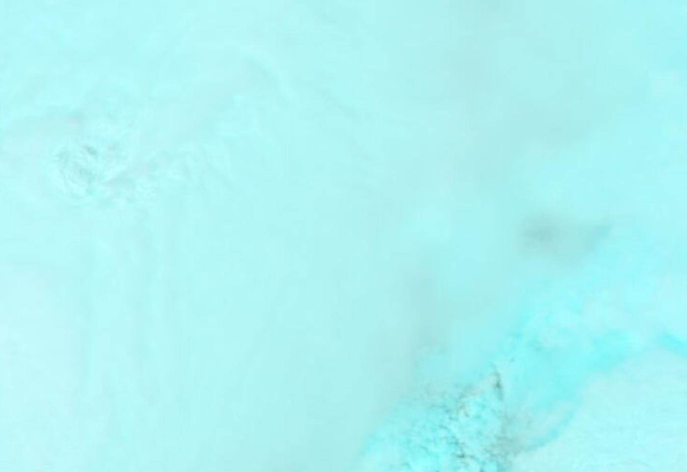
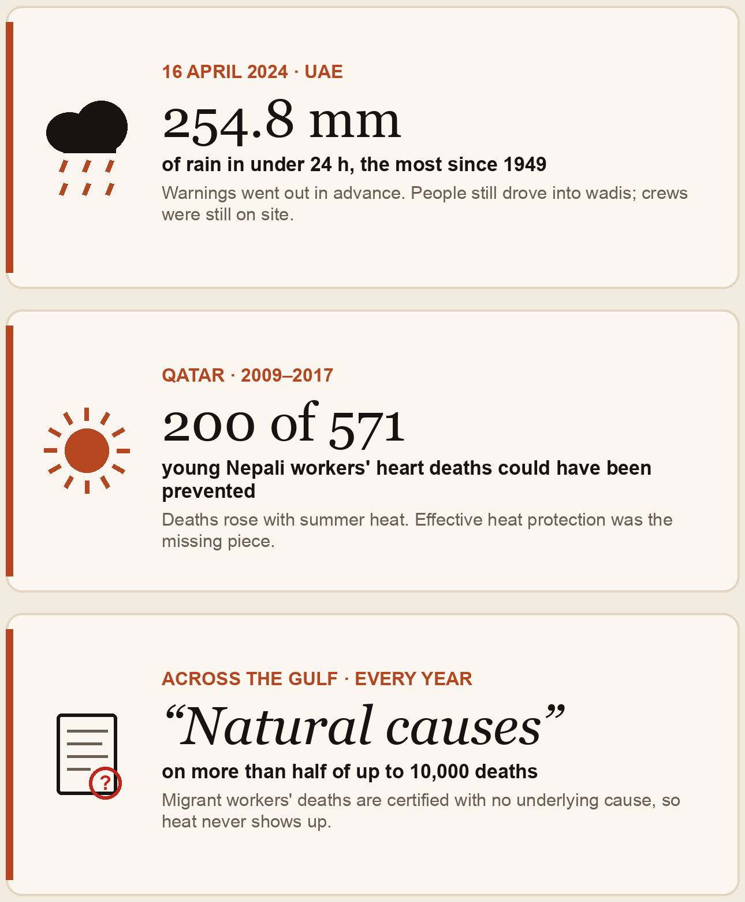

# NABD Orbit نبض

## Supernova × SpacePoint Hackathon

Right now, a satellite is crossing the UAE. It sees clouds over the Hajar, ships in Hormuz, cities spreading into the sand. **Most of it goes unused.**

You get **real satellite data** and one week to build something that matters — then the top 8 teams pitch live to the judges.

**We built NABD Orbit** so that pass is not wasted when the next flood hits.

> **Goals:** map floods within hours, not days · assess damage to roads and buildings · learn from the **April 2024 UAE floods**  
> **Data:** Sentinel-1 radar · Sentinel-2 · Copernicus DEM · **NASA GIBS** (live)

**Demo:** http://127.0.0.1:3848/orbit · **Repo:** [Shreeya1-pixel/Qwen_Supernova](https://github.com/Shreeya1-pixel/Qwen_Supernova)


---

## From orbit — NASA GIBS (live)

Connected to **NASA GIBS WMS** (keyless). These frames are real GetMap pulls for the April 2024 UAE flood week over Dubai–Hatta:

| MODIS flood water (2-day) | False colour 7-2-1 |
|:---:|:---:|
|  |  |
| **VIIRS true colour** | **VIIRS night lights** |
|  |  |


<sub>NASA GIBS · April 2024 · also aerosols, water vapour, SST on `/orbit` and `GET /api/orbit/nasa`.</sub>

| Source | Role |
|---|---|
| **NASA GIBS** | Flood product, false-colour, night lights, vapour, SST |
| **Sentinel-1 / Sentinel-2 / Copernicus DEM** | Live STAC catalogue over the AOI (`/api/orbit/scenes`) |

---

## The problem



Warnings existed. Responders still needed **where the water was** and **which roads and buildings were cut** — in hours, not days.


<sub>Hatta, April 2024: early-warning backtest with archived forecasts (39 h lead on the weather threshold).</sub>

---

## What runs today

| Goal | What you get |
|---|---|
| **Map floods within hours** | Prototype Sentinel-1-style extents on Hatta + Dubai South + NASA flood / false-colour wall. Live STAC proves S1/S2/DEM coverage. |
| **Damage to roads & buildings** | **Overture Maps**: 3,000+ real hospitals, schools, clinics triaged against the mask (`/api/orbit/facilities`). |
| **April 2024** | NCM **254.8 mm**, archive rainfall, NASA event-day imagery, Hatta case. |


**Latency (T+4 / T+6 / ~42 h)** = design targets for a radar-first pipeline vs ~T+48 optical clear — **not** measured wall-clock of a SAR processor in this repo.

---

## Architecture

<p align="center"></p>

---

## APIs

| Endpoint | Role |
|---|---|
| `GET /api/orbit/nasa` | **NASA GIBS** satellite wall |
| `GET /api/orbit/scenes` | Sentinel-1 · Sentinel-2 · Copernicus DEM |
| `GET /api/orbit/facilities` | Overture hospitals / schools / clinics |
| `GET /api/orbit/phases/{id}` | Flood + damage GeoJSON |
| `GET /api/orbit` | Briefing + KPIs |

---

## Run locally

```bash
cd backend && python3 -m venv .venv && source .venv/bin/activate
pip install -r requirements.txt
uvicorn nabd.main:app --host 127.0.0.1 --port 8040

cd frontend && npm install && npm run dev
```

Open **http://127.0.0.1:3848/orbit**

---

<sub>NASA GIBS · Copernicus via Element84 STAC · Overture Maps 2026-10-21.0 · Open-Meteo · © OpenStreetMap.</sub>
