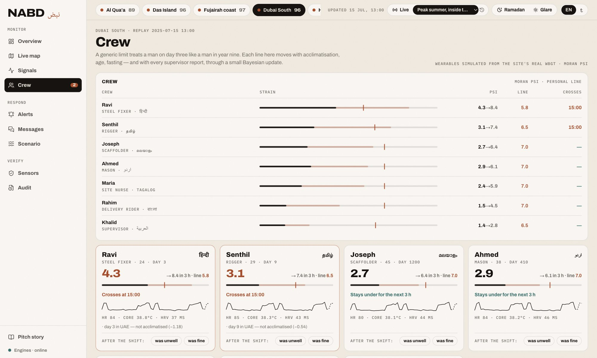
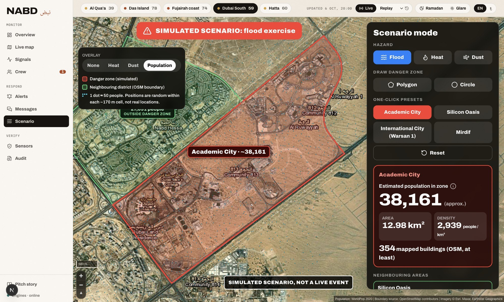
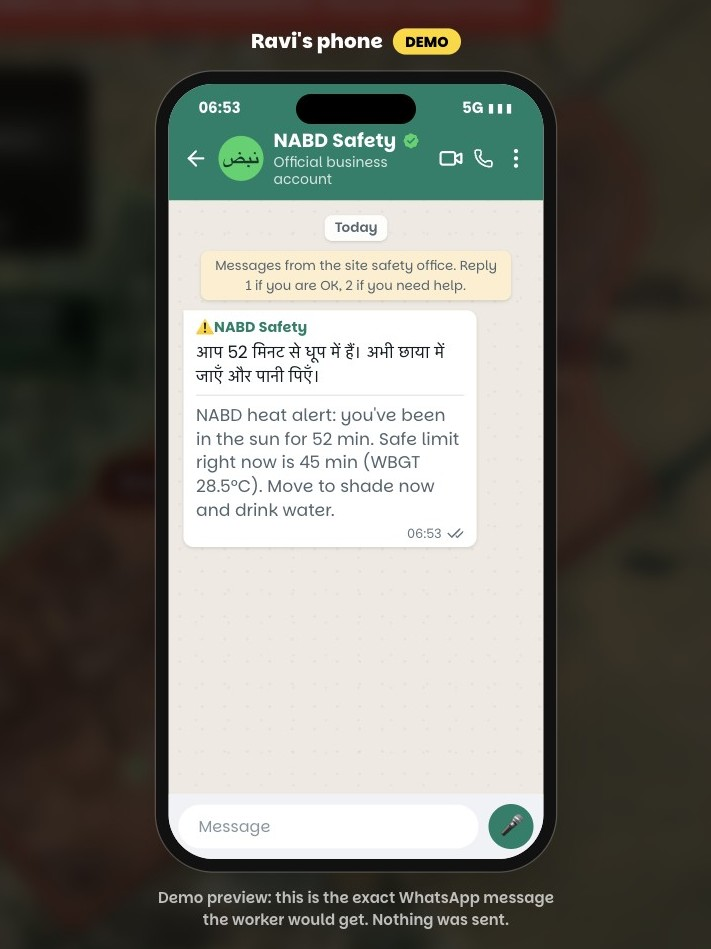

# NABD نبض — read the land before the body

> *Nabd* means **pulse**. The land has one, and so does every worker on it.

**NABD is a software + Earth-observation early-warning platform** for heat, flood and dust in extreme environments. It turns live satellite and weather data into **site-level decisions** and gets the warning to each worker **in their own language** — including **when there is no network**.

> **Supernova × Spacepoint (BITS Pilani Dubai)** — **Theme 04: First Responders from Orbit** (data prototype, not hardware).  
> Open **Orbit response** → [`/orbit`](http://127.0.0.1:3848/orbit) · full brief: **[HACKATHON.md](HACKATHON.md)**

📄 **[Pitch deck](docs/NABD_pitch.pdf)** · 🧭 **[Architecture](docs/ARCHITECTURE.md)** · 🔬 **[Methods](docs/METHODS.md)** · 🎤 **[Demo script](docs/SPEAKER_NOTES.md)** · 🔌 **[API](docs/API.md)**


<sub>Overview replaying 15 July 2025, 13:00 at Dubai South — index 96, STOP WORK, personal limits crossed for new arrivals.</sub>

---

## At a glance

| | |
|---|---|
| **Problem** | Warnings exist but miss the person: wrong time, wrong place, wrong language, no signal. |
| **What we built** | Working dashboard + API: hazard index, exposure graph, personal limits, 3-check council, **8-language alerts**, **off-grid phone relay**, and **orbit flood + damage triage**. |
| **Proof** | Hatta flood **16 Apr 2024** flagged **39 h early**; **25/25** black-flag heat days in Aug 2025 by 05:00. |
| **Pitch type** | **Data / software prototype** (satellite + weather + responder UI). Wearables/BLE are last-mile options — not a hardware submission. |
| **Cost to run** | Free, keyless public data sources. |

---

## Features (everything we stress)

### Multilingual — the warning in the language people actually use
- **8 worker languages:** English, Arabic, Hindi, Urdu, Malayalam, Tamil, Tagalog, Bengali.
- **UI bilingual:** English / Arabic with full **RTL** layout.
- **Codeswitch intake (on-device, no LLM):** reads Hindi-in-Latin, Arabizi, and mixed English the way crews actually type (e.g. *“bhai sar ghoom raha hai, paani khatam, dizzy”*).
- Symptoms raise that worker’s strain; the council re-votes; the **reply goes back in their language**.
- WhatsApp / relay frames carry **codes, not English-only prose**, so each phone renders Hindi, Malayalam, Tagalog or Arabic locally.


### Offline / off-grid — works when the tower doesn’t
- **21-byte signed alert frame** — small enough for one **Bluetooth LE** advertisement (no pairing, no internet).
- Each phone **verifies the signature**, ignores duplicates, **relays hop-to-hop**, and shows the alert in the owner’s language.
- Acknowledgements travel back the same way so the site office sees who got it.
- Demo uses the browser `BroadcastChannel` as a stand-in for BLE; the frame format is what handsets would carry.
- Backend can serve a **cached weather snapshot** if the network drops, labelled stale on screen — demos don’t go blank.


### Orbit flood response — Theme 04 (hours, not days)
- **Flood water mask** ready by ~**T+4 h** (prototype Sentinel-1 style extents).
- **Road + building damage triage** by ~**T+6 h** (clear / partial / impassable · safe / impacted / critical).
- Worked example: **16 April 2024 UAE floods** (Hatta + Dubai South), vs typical optical clear ~**T+48 h** (~**42 h** gained).
- Event rainfall series from **Open-Meteo archive** (ERA5-class) near Hatta.
- Page: **`/orbit`** · API: `/api/orbit`, `/api/orbit/phases/{id}`, `/api/orbit/rainfall`.

### Personal protection — not one limit for the whole crew
- Each worker has a **personal strain line** that moves with acclimatisation, age and Ramadan fasting.
- Learns from supervisor feedback (confirmed / false alarm) within safe Bayesian bounds.
- Projected ETA when someone will cross their line — so supervisors act *before* collapse.



### Deterministic safety council — AI does not decide stop-work
- Three independent checks must agree: **the land**, **the body**, **the data**.
- If they diverge → **human supervisor decides**; nothing automatic.
- Engines are deterministic; every decision lands in a **hash-chained audit log**.
- Optional Gemini writes a **briefing only** — never a safety vote.

### Live land reading
- **NABD Index 0–100** with memory: heat fades in hours, dust over a day, warm sea over ~3 days.
- Live **Open-Meteo** weather / air / marine + **NASA GIBS** land heat & dust layers.
- Sites across desert, mountain flash-flood, coast, offshore and mega-construction.
- Replay any archived hour (including April 2024 and peak summer heat).

### Scenario & last-mile reach
- Draw or pick an OSM district → **WorldPop** people in zone, area, mapped buildings.
- Exposure watch: live sun / WBGT → safe minutes outdoors → WhatsApp-style alert in-language.
- UAE playbooks: work–rest cycles, hydration, shift heavy tasks.

<table>
<tr>
<td width="64%"></td>
<td width="36%"></td>
</tr>
</table>

### Trust & integrity
- HMAC-signed field sensors, physics / satellite cross-checks.
- Built-in **Mirage red team** to probe spoofed telemetry.
- Tamper-evident audit trail for inspectors, insurers and ESG.

### Live map
HD satellite basemap, feels-like / wet-bulb field over the UAE, NASA LST & AOD overlays, site markers.


---

## Feature matrix

| Capability | Detail |
|---|---|
| Multilingual alerts | 8 languages; codeswitch intake; EN/AR UI + RTL |
| Offline mesh | 21-byte signed BLE frame; hop relay; per-phone language render |
| Orbit flood map | T+4 h water mask · T+6 h road/building triage · Apr 2024 case |
| Early warning | Index + tipping signals; 39 h lead on Hatta flood backtest |
| Personal limits | Acclimatisation / age / fasting; feedback-tuned |
| Council | Land × body × data; human on disagreement |
| Scenario planning | OSM zones, WorldPop, buildings, sun exposure watch |
| Channels | Dashboard, WhatsApp (demo), off-grid relay, optional Jira |
| Audit | Hash-chained log of every automatic / held decision |
| Data cost | Free public EO + weather (no paid API required for core demo) |

---

## The problem: the warning existed, but it didn’t reach the person

| Gap | Today | What a site needs |
|---|---|---|
| Calendar vs physics | Midday ban 12:30–15:00, 15 Jun–15 Sep | Danger by the hour, any date |
| Region vs site | “Heavy rain in the eastern region” | “Stop block C at 11:00” |
| Language | Arabic + English only | Hindi, Malayalam, Tagalog, Urdu, Bengali… |
| Connectivity | SMS / apps | Works in a wadi with **no signal** |

- **16 April 2024:** 254.8 mm in &lt;24 h (record since 1949); warnings existed; people still died / flights cancelled.
- Heat deaths among migrant workers across the Gulf remain a last-mile failure, not a missing forecast.

**Scale:** 83.6% of workers in the Arab States exposed to excessive heat (ILO 2024).

---

## How it works (six steps)

1. **Data** — satellite, weather, sensors  
2. **Trust** — signed probes, cross-checks, red team  
3. **NABD Index** — 0–100 with hazard memory + forecast  
4. **Exposure** — hazard → pathway → who → outcome  
5. **Council** — land + body + data must agree  
6. **Alert** — **in-language**, and **phone-to-phone if offline**

<p align="center"></p>

---

## Proof: we replayed real days

Open-Meteo **Previous Runs** only — no look-ahead (unit-tested).

| Case | Result |
|---|---|
| **Hatta flood, 16 Apr 2024** | Flagged **39 h** before danger threshold (obs alone: 3 h) |
| **Dubai South, Aug 2025** | **25/25** black-flag days by 05:00 · FAR **0.19** |
| **Dubai South, Sep 2025** | **14/14** · FAR **0.53** (over-warns on purpose) |


Method & caveats: [docs/METHODS.md](docs/METHODS.md).

---

## What’s real vs simulated

| Real / live / archived | Simulated (labelled on screen) |
|---|---|
| Open-Meteo weather, air, marine + archive | Wearable HR / core temp (from site WBGT) |
| NASA GIBS / EONET | Scenario people & outdoor minutes |
| OSM boundaries & buildings, WorldPop | Orbit flood polygons (prototype SAR-style corridors) |
| Orbit rainfall archive series | BLE radio (browser BroadcastChannel in demo) |
| Audit log, deterministic engines | WhatsApp send (preview unless keys set) |

---

## Why buyers care

- **Compliance:** midday-ban fines **AED 5,000 / worker, up to 50,000** (MoHRE) — audit proves action.  
- **Fewer incidents** offshore / on mega-sites.  
- **More safe working hours** by shifting into forecast-safe windows.  
- **Reach:** multilingual + offline closes the last mile regulators and crews both need.

**Buyers:** contractors, oil & gas, utilities, delivery fleets, emergency management.  
**Model:** per-site subscription + worker seats (~AED 2,500 / site / month hypothesis).

---

## Honest limits

| Today | Next |
|---|---|
| Wearables simulated | WHOOP / Apple Watch pilots |
| Orbit masks = prototype SAR-style extents | Live Sentinel-1 / GEE pipeline |
| Heat can over-warn (Sep FAR 0.53) | Calibrate on local incidents |
| Demo BLE is browser mesh | Android BLE first; per-device keys |
| iOS background BLE limits | Documented; Android-first path |

---

## Tech stack

| Layer | What |
|---|---|
| Frontend | Next.js 16, React 19, Tailwind 4, MapLibre, Turf, **EN/AR + RTL** |
| Backend | Python FastAPI; deterministic engines; offline-capable tests |
| Data | Open-Meteo, NASA GIBS/EONET, OSM, WorldPop |
| Out | WhatsApp Cloud API (optional), **21-byte signed BLE frame**, hash-chained audit |
| Orbit | `/api/orbit*` flood phases + damage GeoJSON + rainfall |

---

## Run it (localhost)

Needs Python 3.11+ and Node 20+.

```bash
# Backend → http://127.0.0.1:8040
cd backend && python3 -m venv .venv && source .venv/bin/activate
pip install -r requirements.txt
uvicorn nabd.main:app --host 127.0.0.1 --port 8040

# Frontend → http://127.0.0.1:3848
cd frontend && npm install && npm run dev
```

Open <http://127.0.0.1:3848>.

**Judge / demo path**
1. **`/orbit`** — Theme 04 flood timeline + damage map (Apr 2024).  
2. Top bar **Replay → Peak summer** — personal limits + STOP WORK.  
3. **`/messages`** — multilingual codeswitch intake.  
4. **`/alerts`** — playbook + **off-grid relay** phones.  
5. **`/scenario`** — zone + WhatsApp-style alert preview.

| Page | Shows |
|---|---|
| `/` | Overview: index, council, map, crew, playbook, off-grid |
| `/orbit` | **First Responders from Orbit** — flood + damage triage |
| `/map` | Full live map |
| `/signals` | Tipping stats, validation, exposure graph |
| `/crew` · `/messages` · `/alerts` | Personal lines · **multilingual** · playbooks + **offline relay** |
| `/scenario` | Population zone + exposure watch |
| `/story` · `/relay?slot=0..4` | Pitch story · single off-grid phone |

Optional keys in `NABD/.env` (see `.env.example`): `GEMINI_API_KEY`, `WHATSAPP_*`.  
Population grid for Scenario: WorldPop GeoTIFF → `python scripts/prep_population.py …` (see prior docs).

---

<sub>Boundaries: OpenStreetMap · Population: WorldPop 2020 · Weather: Open-Meteo · Imagery: NASA GIBS, Esri. Sources: [docs/METHODS.md](docs/METHODS.md#sources).</sub>
